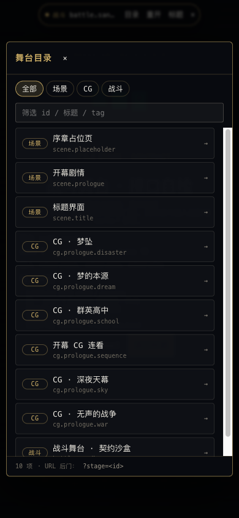
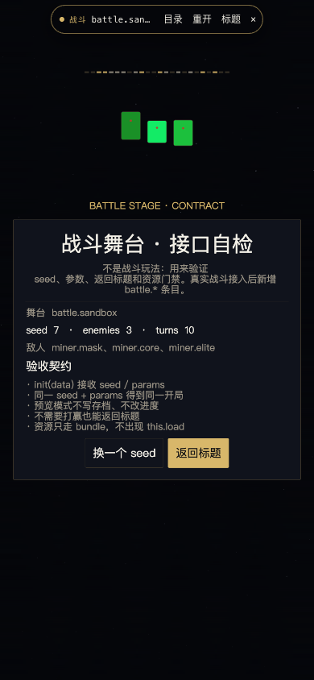
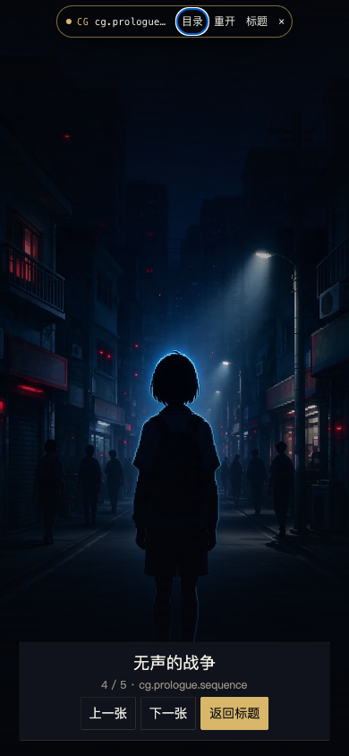
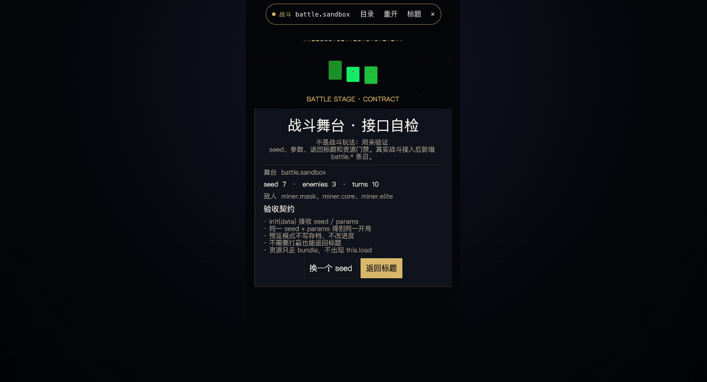
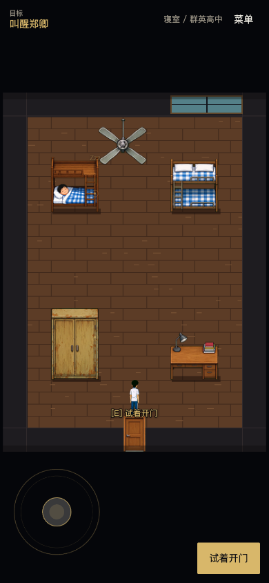
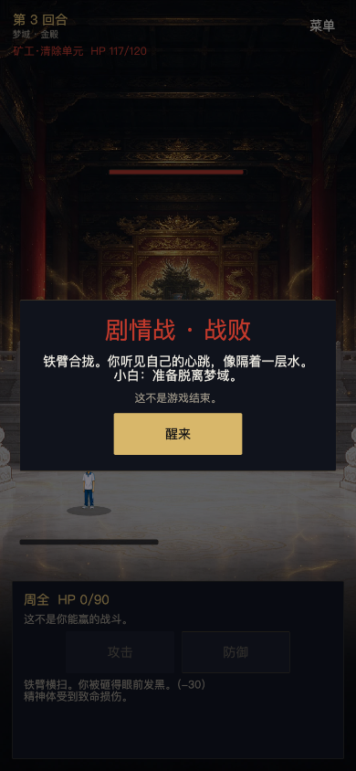

# 舞台预览与测试后门

> 状态：v1.1（2026-10-25，新增第一章第一节舞台）
> 适用：Web、Android（Cordova）、自动化测试、人工验收
> 唯一真值：`src/dev/stage-catalog.ts`
> 相关 ADR：[0005-stage-preview.md](adr/0005-stage-preview.md)

## 0. 一句话

**每个可玩场景、CG、战斗都登记一个稳定 ID；测试时用 `?stage=<id>`、`__AVM__.stages.go('<id>')` 或舞台 HUD 目录单独打开，不必从标题一路点过去。**

正常玩家流程（Boot → 标题 → 开幕 → 后续章节）完全不受影响；这些入口只在显式调用时出现。

---

## 1. 目的与非目标

### 1.1 目的

1. **能单点**：任意场景/CG/战斗不依赖前置剧情、存档或标题流程，能独立进入。
2. **能复现**：同一 `seed + params` 得到同一开局/同一画面，便于截图对比与回归。
3. **能验收**：产品/美术/QA 不用记操作路径，改 URL 或点 HUD 目录即可。
4. **能扩展**：后续新增章节、Boss 战、CG 时，接入步骤固定，测试会强制登记。
5. **不绕过资源规则**：预览走 `loadSceneResources()`（等于 `AssetService.ensure()` + 强制加载页 + 目标 `create` 后回收），不会在场景里出现 `this.load`。

### 1.2 非目标

- 不做玩家可见的「关卡选择」「CG 鉴赏」「战斗回放」产品功能。
- 不做存档编辑器、GM 数值面板、热重载、联网控制台。
- 不替代正式章节流程；预览只是旁路。
- 不在预览模式里写存档、成就、进度或分析埋点。

---

## 2. 三类舞台

| kind | 是什么 | 宿主场景 | 当前例子 | 登记内容 |
| --- | --- | --- | --- | --- |
| `scene` | 真正的 Phaser 场景 | 场景自身 | `scene.title`、`scene.prologue`、`scene.placeholder` | `sceneKey`、`requires` |
| `cg` | 一张 CG 或一组 CG 帧 | 通用 `cg-stage` | `cg.prologue.disaster`、`cg.prologue.sequence` | `frames[]`、`requires` |
| `battle` | 战斗场景 | 战斗场景自身 | `battle.sandbox`（契约沙盒，不是玩法） | `sceneKey`、`requires`、`options` |

CG 不需要为预览单独写场景：在目录里登记 `key + caption + holdMs`，通用查看器负责全屏展示和翻页。

---

## 3. 代码结构

| 文件 | 职责 |
| --- | --- |
| `src/dev/stage-types.ts` | 舞台类型、ID 规则、`StageLaunchContext`、seed/params 辅助函数 |
| `src/dev/stage-catalog.ts` | **唯一真值**：所有舞台条目、查找、排序、结构校验 |
| `src/dev/stage-query.ts` | `?stage=` 解析与 URL 生成（纯函数） |
| `src/dev/stage-runner.ts` | 唯一启动入口 `launchStage()`、控制台 API、退出/重开 |
| `src/dev/stage-hud.ts` | 预览 HUD（DOM），目录、筛选、重开、返回标题 |
| `src/dev/random.ts` | 确定性随机 `mulberry32` / `hashSeed` / `randomInt` |
| `src/app/scene-keys.ts` | 场景 key 白名单；新增内容场景必须登记 |
| `src/scenes/cg-stage-scene.ts` | 通用 CG 查看器 |
| `src/scenes/battle-sandbox-scene.ts` | 战斗舞台契约自检页（非玩法） |
| `test/stage-catalog.test.ts` | 目录结构、模块同步、内容场景覆盖 |
| `test/stage-query.test.ts` | URL 解析/生成/回环 |
| `test/stage-context.test.ts` | 上下文、参数、确定性随机 |

依赖方向：`stage-query` / `stage-types` / `stage-catalog` 都是无 Phaser 的纯模块；`stage-runner` / `stage-hud` / 场景才碰 Phaser 和 DOM。新增逻辑优先放进纯模块并补单测。

---

## 4. ID 规则

### 4.1 语法

```text
<kind>.<segment>[.<segment>...]
kind      = scene | cg | battle
segment   = [a-z0-9][a-z0-9-]*
```

- 全小写 ASCII；用点分层；段内可用连字符。
- 禁止：空格、中文、下划线、大写、把 kind 写在中间。
- 正则见 `STAGE_ID_PATTERN`；URL 解析会先 `trim + toLowerCase`，但目录登记必须写规范形式。

### 4.2 命名建议

| 类型 | 建议 | 例 |
| --- | --- | --- |
| 场景 | `scene.<流程阶段>.<可选子场景>` | `scene.title`、`scene.prologue`、`scene.ch01.school` |
| CG | `cg.<过场/章节>.<名字>` | `cg.prologue.disaster`、`cg.ch01.crown-hall` |
| 战斗 | `battle.<章节>.<遭遇>` | `battle.ch01.tutorial`、`battle.v3.ice-prison-boss` |

- **ID 是验收契约**：截图、视频、缺陷单、自动化都在用它。上线后不要改名；必须改名时保留 `aliases: ['旧.id']`，旧 URL 继续可用。
- 一个 ID 只对应一种内容；不要复用给重制版（新建 ID）。
- 目录 `title` 给人和 HUD 看，尽量不剧透；`description` 可写技术说明。

---

## 5. 三个后门入口

### 5.1 URL：`?stage=<id>`

最常用。Boot 在字体就绪后解析；有合法 `stage` 就跳过标题，直接进舞台。

```text
http://localhost:5173/?stage=scene.prologue
http://localhost:5173/?stage=cg.prologue.disaster&hud=0
http://localhost:5173/?stage=cg.prologue.sequence&frame=3
http://localhost:5173/?stage=battle.sandbox&seed=7&enemies=miner.mask,miner.core&turns=10
```

| 参数 | 类型 | 默认 | 说明 |
| --- | --- | --- | --- |
| `stage` | stage id | — | 必填；不合法则停在标题并提示 |
| `seed` | uint32 整数 | `1` | 确定性种子；负数按 `>>> 0` 归一 |
| `skip` | `1/true/yes/on` | `false` | 请求跳过可跳过的演出；各舞台自行决定是否支持 |
| `frame` | ≥0 整数 | `0` | CG 起始帧（0 起）；其他类型原样传入 |
| `hud` | `0/false/no/off` | `true` | 是否显示预览 HUD；截图验收传 `hud=0` |
| 其他 | 字符串 | — | 原样进入 `context.params`，战斗可用 `enemies`、`turns` 等 |

行为：

- 资源由 `loadSceneResources(entry.requires)` 加载：加载页总是显示（最短 420ms），文案为「预览 · <标题>」；目标场景 `create` 后释放不属于它的 bundle。
- 未知 ID / 非 ready / 资源失败：回到标题，并在底部显示错误提示（截图见 §10）。
- `?stage=` 不会修改存档；当前也没有存档系统，但规则从现在生效。
- Cordova 安装包没有地址栏：用 HUD 目录或 `chrome://inspect` 的控制台；见 §5.2。

### 5.2 控制台：`__AVM__.stages`

`window.__AVM__` 在 `new Phaser.Game` 后立即挂载，不等标题。

```js
__AVM__.stages.list()                     // 全部舞台摘要
__AVM__.stages.list(false)                // 只看 ready
__AVM__.stages.get('scene.prologue')      // 查一个
__AVM__.stages.current()                  // { stage, context } 或 null
await __AVM__.stages.go('cg.prologue.disaster')
await __AVM__.stages.go('battle.sandbox', { seed: 7, params: { enemies: 'miner.mask' } })
await __AVM__.stages.restart()
await __AVM__.stages.title()              // 退出预览，回正常标题流程
__AVM__.stages.url('cg.prologue.disaster', { hud: false })
__AVM__.stages.hud(false)                 // 隐藏/显示 HUD；返回实际状态
```

注意：

- `go()` 只切场景，**不会改地址栏**；要分享/复现请用 `url()` 生成链接再刷新。
- `go()` 返回 `StageSummary`，`current().context` 里有真实 seed/params/origin。
- 控制台 API 在正式包里也存在（原因见 §11）。

Android 真机：

```text
chrome://inspect → 选中 WebView → Console
__AVM__.stages.go('scene.prologue')
```

### 5.3 代码：`launchStage()`

自动化脚本、自定义调试场景、未来的 QA 工具都调用它：

```ts
import { launchStage, exitStagePreview } from './dev/stage-runner';

await launchStage(game, 'battle.ch01.tutorial', {
  seed: 42,
  skip: true,
  params: { enemies: 'miner.mask,miner.core', turns: 20 },
  origin: 'code',
});
```

- **不要**在预览路径里直接 `scene.start(key)`：会绕过资源门禁、HUD、`active` 记录和退出清理。
- 正常玩家流程仍用 `enterModule(from, id)`；两者职责不同。
- 启动器会先 `await loadSceneResources(...)`，再停掉所有内容场景（保留 loader），最后 `scene.start` 并在目标 `create` 后回收旧 bundle；这是唯一用全局场景管理做「显式跳转」的地方。
- 舞台内部推进（例如 prologue → ch01Dorm）退出预览时，HUD 会自动消失；这是预期行为。

### 5.4 预览 HUD

满足以下任一条件时出现：

- URL 带合法 `stage` 且 `hud` 未关闭；
- 控制台 `go()` / `hud(true)`；
- HUD 目录里点选。

操作：

| 控件 | 行为 |
| --- | --- |
| 顶部胶囊（`STAGE <id>`） | 打开/关闭舞台目录 |
| 目录 | 按 全部/场景/CG/战斗 筛选，可按 id/标题/tag 搜索，点条目直接启动 |
| 重开 | 用当前 seed/params 重新进入；场景内部随机重置 |
| 标题 | 结束预览，回正常标题 |
| × | 隐藏 HUD，只留右上角小圆点 |
| `Alt+Shift+D` | 隐藏/显示 HUD |
| `Esc` | 关闭目录面板（不会触发场景返回） |

HUD 是**调试 DOM**，不占设计空间、不抢游戏输入焦点；根容器 `pointer-events: none`，只有胶囊/面板接收点击。浏览器截图里会拍到它；需要干净截图时加 `&hud=0`。



---

## 6. 预览舞台契约

### 6.1 注入的上下文

```ts
interface StageLaunchContext {
  stageId: string;
  kind: 'scene' | 'cg' | 'battle';
  preview: true;          // 恒为 true
  seed: number;           // 默认 1，uint32
  skip: boolean;
  frame: number;          // CG 已按帧数钳制
  params: Readonly<Record<string, string>>;
  origin: 'url' | 'console' | 'hud' | 'code';
  startedAt: number;
}
```

场景通过 `init(data)` 接收；正常流程不会传这个对象，所以 `init` 必须容忍 `undefined`。

```ts
init(data: unknown): void {
  const context = isStageLaunchContext(data)
    ? data
    : createStageContext({ id: 'scene.prologue', kind: 'scene' }, { origin: 'code' });
  this.preview = context.preview;
}
```

### 6.2 必须遵守

1. **预览不写存档/进度/成就**。有存档系统后，所有写入口先判断 `context.preview`。
2. **随机必须确定性**。用 `context.seed` + `mulberry32` / `hashSeed`；同一 seed + params 的开局、抽卡顺序、敌人行动顺序一致。不要在预览可达逻辑里直接 `Math.random()`。
3. **资源只在 bundle 里**。场景里出现 `this.load` 即违反 AGENTS 硬规则；预览也不破例。
4. **不依赖标题/前情**。不能要求玩家先点过「开始游戏」、先有存档、先看完过场。
5. **能退出**。`onBack()` 或界面按钮至少有一条回标题的路；战斗不需要先打赢才能退出。
6. **不自己解析 `?stage=`**。所有入口统一走 `launchStage`；场景只读注入的 context。
7. **`skip` 是可选承诺**。支持就跳过淡入/演出；不支持可以忽略，但要在 `description` 或章节里说明。
8. **`params` 是开放扩展**。用 `stageParam` / `stageIntParam` / `stageBoolParam` 读取，非法值回退默认，不要让场景崩溃。
9. **标题不剧透**。目录会随包分发；`title` 用人话，具体剧情放场景内。

### 6.3 舞台内部跳转

预览场景内部仍可以正常走 `enterModule`（例如 CG 查看器点「返回标题」、prologue 播完去 ch01Dorm）。一旦宿主场景 shutdown，HUD 会在下一 tick 自动卸载并把 `current()` 置空——预览结束，不会有「HUD 还停在上一幕」的假状态。

---

## 7. 新增一个场景

以 `scene.ch01.school` 为例：

1. `src/app/scene-keys.ts`
   ```ts
   export const SCENE_KEYS = { ..., ch01School: 'ch01-school' } as const;
   export const CONTENT_SCENE_KEYS = [..., SCENE_KEYS.ch01School];
   ```
2. `src/main.ts` 场景列表加入 `Ch01SchoolScene`。
3. `src/dev/stage-catalog.ts` 登记：
   ```ts
   {
     id: 'scene.ch01.school',
     kind: 'scene',
     sceneKey: SCENE_KEYS.ch01School,
     title: '第一章 · 群英高中',
     status: 'ready',
     requires: ['ui', 'ch.01'],
     description: '第一章现实线场景。',
   }
   ```
4. 场景里 `init(data)` 读 context；`requires` 与实际资源一致；禁止 `this.load`。
5. 跑 `pnpm check`：目录单测会检查「每个 `MODULES` 场景都有同 gate 的舞台条目」「每个内容 scene key 都至少有一个入口」。
6. 验收：
   ```text
   /?stage=scene.ch01.school
   ```

**只加场景、不登记目录 = `pnpm check` 失败**（`stage-catalog.test.ts` 的内容场景覆盖/模块同步）。

---

## 8. 新增一张 CG / 一段 CG

1. 在 `src/assets/bundles.ts` 登记 image key，跑 `pnpm assets:scan && pnpm assets:check`。
2. 在目录里登记：
   ```ts
   {
     id: 'cg.ch01.crown-hall',
     kind: 'cg',
     title: 'CG · 金殿',
     status: 'ready',
     requires: ['cutscene.ch01'],
     frames: [
       { key: 'img.cg.ch01.crown_hall', caption: '金殿', holdMs: 2400 },
     ],
   }
   ```
   一组连续 CG 用一个条目的多帧；验收可 `&frame=2` 直接看第 3 张。
3. 不需要新场景；`CgStageScene` 自动显示，素材共用封面裁切与底部说明。
4. 验收：
   ```text
   /?stage=cg.ch01.crown-hall&hud=0
   /?stage=cg.ch01.sequence&frame=2&hud=0
   ```

CG 构图要求见 `docs/ART-STYLE.md`：主体放中心 4:5 安全区；查看器会 cover 裁切，底部 20% 会压说明面板。

---

## 9. 新增一场战斗

战斗是三类里契约最重的：不仅要「打开」，还要能验收关键局面。

### 9.1 必做

1. 场景 + `scene-keys.ts` + `main.ts`。
2. 目录条目：
   ```ts
   {
     id: 'battle.ch01.tutorial',
     kind: 'battle',
     sceneKey: SCENE_KEYS.battleCh01,
     title: '战斗 · 教学',
     status: 'ready',
     requires: ['battle.common', 'battle.ch01.tutorial'],
     options: [
       { name: 'seed', description: '确定性种子', example: '42' },
       { name: 'enemies', description: '敌人 id，逗号分隔', example: 'miner.mask' },
       { name: 'phase', description: '开场/中局/胜利验收快照', example: 'victory' },
     ],
   }
   ```
3. `init(data)` 接收 `seed` / `params`；同一输入同一开局。
4. 预览不写存档；退出不需要胜利。
5. 资源只走 bundle。

### 9.2 状态快照约定（接入战斗时落地）

为了让「战斗单独显示」不仅是开场画面，战斗场景应支持以下 `params.phase`（或等价命名，写进自己的 `options`）：

| phase | 期望画面 | 验收用途 |
| --- | --- | --- |
| `opening` | 敌方登场、先手/站位 | 首帧构图、UI 层级 |
| `mid` | 若干回合后，双方有状态/伤害数字 | HUD、技能、数值可读性 |
| `victory` | 结算面板/掉落 | 结算流程、按钮焦点 |
| `defeat` | 失败面板 | 失败流程、返回 |
| `boss`（可选） | Boss 二阶段/机制 | 专项验收 |

未实现对应 phase 时，退回 `opening` 并在控制台 warning；不要白屏。

### 9.3 当前状态

目录里的 `battle.sandbox` 只是**契约自检页**：显示 seed、敌人列表、回合数、资源门禁和返回标题，不是战斗玩法。真实战斗接入后新增 `battle.*` 条目，把沙盒保留作回归入口。



---

## 10. 验收清单与示例

### 10.1 当前目录

| id | 类型 | 说明 |
| --- | --- | --- |
| `scene.title` | 场景 | 标题界面 |
| `scene.prologue` | 场景 | 完整开幕 |
| `scene.placeholder` | 场景 | 序章占位页（仅预览；正常流程不再进入） |
| `scene.ch01.dorm` | 场景 | 第一章 · 第一节 寝室；phase=opening/explore/after/complete，debug=1 显示碰撞 |
| `battle.ch01.first` | 战斗 | 第一章剧情战；phase=opening/mid/defeat；主角伤害固定 1、必败 |
| `cg.ch01.phone` | CG | 第一章 · 手机白光 |
| `cg.ch01.xiaobai` | CG | 第一章 · 小白登场 |
| `cg.ch01.wake` | CG | 第一章 · 醒来 |
| `cg.prologue.sequence` | CG | 5 张开幕配图连看 |
| `cg.prologue.sky` | CG | 深夜天幕 |
| `cg.prologue.dream` | CG | 梦的本源 |
| `cg.prologue.disaster` | CG | 梦坠 |
| `cg.prologue.war` | CG | 无声的战争 |
| `cg.prologue.school` | CG | 群英高中 |
| `battle.sandbox` | 战斗 | 契约沙盒（非玩法） |

> 开幕的 ▶▶ 自动播放图标在右上角，预览 HUD 展开时会盖住它：预览里想切自动，先用 `hud=0`，或点 HUD 的「×」收起。

### 10.2 手工验收

```bash
pnpm dev
# 1) 正常启动：应到标题，无 HUD
open http://localhost:5173/
# 2) 单场景
open 'http://localhost:5173/?stage=scene.prologue'
open 'http://localhost:5173/?stage=scene.ch01.dorm&phase=explore&hud=0'
open 'http://localhost:5173/?stage=battle.ch01.first&phase=defeat&hud=0'
# 3) 干净 CG 截图
open 'http://localhost:5173/?stage=cg.prologue.disaster&hud=0'
# 4) CG 连播跳到第 4 张
open 'http://localhost:5173/?stage=cg.prologue.sequence&frame=3&hud=0'
# 5) 战斗契约 + seed/params
open 'http://localhost:5173/?stage=battle.sandbox&seed=7&enemies=miner.mask,miner.core&turns=10'
# 6) 未知 id：应回标题 + 底部错误提示
open 'http://localhost:5173/?stage=scene.nope'
```

控制台：

```js
__AVM__.stages.list().map(s => s.id)
await __AVM__.stages.go('cg.prologue.disaster')
await __AVM__.stages.hud(false)
```

预期：

- 加载页出现「预览 · <标题>」，进度真实；资源来自对应 bundle。
- HUD 显示正确 kind/id；目录筛选数量与上表一致（15 项）。
- `?hud=0` 时页面没有 HUD DOM（`document.getElementById('avm-stage-hud') === null`）。
- 未知 id 不白屏；标题正常可点，底部红色提示。
- 从预览里走正常剧情跳转（如 prologue → ch01Dorm）后 HUD 自动消失。

### 10.3 截图

| 图 | 说明 |
| --- | --- |
|  | `cg.prologue.disaster`，`hud=0` |
|  | `cg.prologue.sequence&frame=3` |
|  | `scene.prologue`，HUD 与场景共存 |
|  | `battle.sandbox&seed=7`，HUD 可见 |
|  | HUD 目录 + 筛选 |
|  | 未知 id 回退标题 + 提示 |
|  | 预览结束回到正常标题，HUD 自动消失 |
|  | 1200×648 留边；HUD 不盖游戏主体 |
|  | `scene.ch01.dorm&phase=explore`，390×844 |
|  | `battle.ch01.first&phase=defeat`，390×844 |

---

## 11. 构建、发布与安全边界

- **当前策略：后门随包编译，始终可用。** 项目是单机、无联网排行/交易/成就；知道 ID 最多提前看到内容，不构成作弊收益。
- 普通玩家不会看到入口：只有显式 `?stage=`、控制台或 HUD 目录触发。
- 预览不写存档/进度；不会污染玩家数据（存档系统接入后必须继续遵守）。
- 目录标题随包分发，存在剧透风险；标题保持克制，具体内容放场景内。
- 若未来上架版本需要剥离：在构建期定义开关，并在 `BootScene` 的 query 分支和 `installStageConsole()` 处短路；**当前没有实现这个开关，文档不承诺**。实现时要同步更新本节和 ADR。
- 不要把测试专用参数（如 `phase=victory`）当作正式玩法入口；玩家侧入口仍应由章节流程控制。

---

## 12. 测试与 CI

```bash
pnpm check   # typecheck + vitest + assets:check
```

覆盖：

- `validateStageCatalog()`：ID/别名唯一、kind 前缀、bundle 存在、sceneKey 白名单、CG 纹理在资源闭包里。
- 每个 `MODULES` 场景都有同 `requires` 的舞台条目。
- 每个 `CONTENT_SCENE_KEYS` 至少有一个条目（CG 条目计入 `cg-stage`）。
- `?stage=` 解析/生成回环、非法 id、seed/frame/hud 归一。
- context 默认值、CG 帧钳制、typed params、`mulberry32` 可复现。

新增内容场景时，测试会失败直到目录登记完成——这是有意的。

---

## 13. 常见问题

| 现象 | 原因/解决 |
| --- | --- |
| 打开 `?stage=` 还是标题 | id 拼错/未登记/非 ready；看底部提示与 console warning。 |
| Android 里没法加 query | 安装包无地址栏；用 HUD 目录或 `chrome://inspect` 控制台 `__AVM__.stages.go(...)`。 |
| HUD 不见了 | 可能走了正常剧情跳转（预览结束），或按了 `Alt+Shift+D`/×；控制台 `__AVM__.stages.hud(true)`。 |
| 截图里有 HUD | 加 `&hud=0`。 |
| 控制台 `go` 后地址栏没变 | `go` 只切场景；用 `__AVM__.stages.url(id)` 生成可分享链接。 |
| 预览加载失败 | 与正式进入同一套资源门禁；修 bundle/文件，或看加载页错误。 |
| 场景里 `init` 收到 undefined | 走了正常流程或直接 `scene.start`；用 `isStageLaunchContext` 兜底。 |
| 同一 seed 画面不同 | 检查是否用了 `Math.random()`、时间、设备随机；预览随机必须走 seed。 |

---

## 14. 变更记录

- v1.0（2026-10-24）：首个版本；10 个舞台、URL/控制台/代码三个入口、DOM HUD、CG 查看器、战斗契约沙盒、3 个专项测试文件、文档与截图。
- v1.1（2026-10-25）：新增 `scene.ch01.dorm`、`battle.ch01.first` 与 3 张第一章 CG；开幕完成/跳过改为进入第一章寝室；目录 15 项。
