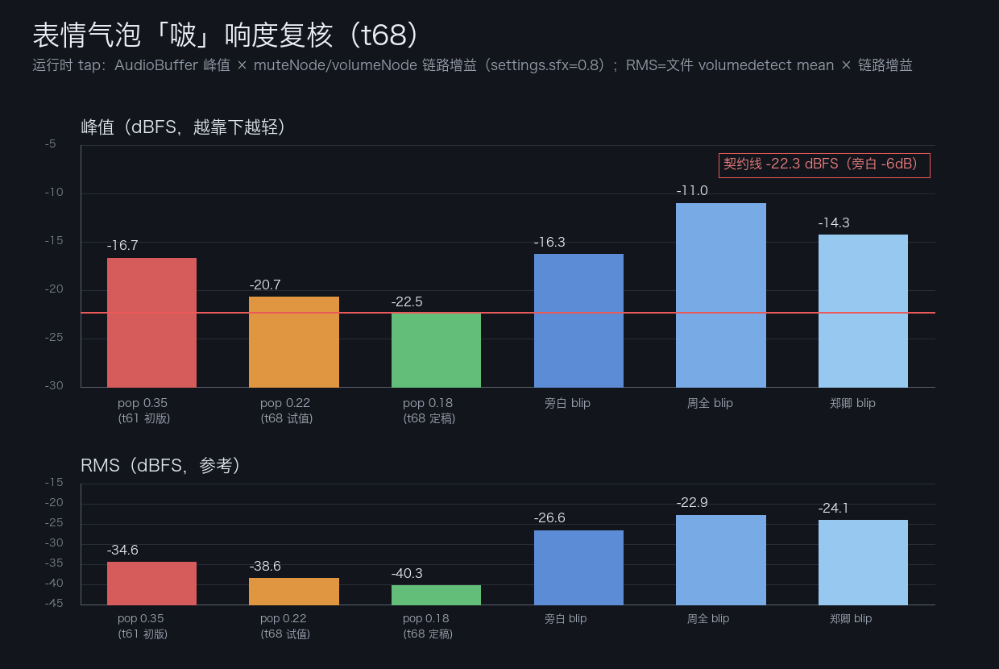

# 表情气泡「啵」响度复核（t68）

> 背景：t61 上线的气泡音效在 t67 统一验收时发现「峰值几乎和旁白逐字 blip 一样响」。
> 本目录记录 t68 按「运行时 tap」口径重测、调低 `BUBBLE_POP_VOLUME`、以及改后复测的证据。

## 结论

| 版本 | `BUBBLE_POP_VOLUME` | 运行时链路增益 | 有效峰值 | 有效 RMS | 比旁白 blip 峰值低 | 比周全 blip 峰值低 | 判定 |
| --- | --- | --- | --- | --- | --- | --- | --- |
| t61 初版 | 0.35 | 0.280 | **−16.7 dBFS** | −34.6 dBFS | 0.4 dB | 5.7 dB | ❌ |
| t68 试值 | 0.22 | 0.176 | −20.7 dBFS | −38.6 dBFS | 4.4 dB | 9.7 dB | ❌ |
| **t68 定稿** | **0.18** | 0.144 | **−22.5 dBFS** | −40.3 dBFS | **6.1 dB** | **11.5 dB** | ✅ |

- 参照物（同一口径）：旁白 blip 峰值 **−16.3 dBFS** / RMS −26.6 dB；周全 blip **−11.0 dBFS** / −22.9 dB；郑卿 blip **−14.3 dBFS** / −24.1 dB。
- 契约：pop 峰值至少比旁白低 **6 dB**、比周全低 **10 dB**，`BUBBLE_POP_VOLUME` 锁在 **[0.18, 0.26]**。
- 定稿比旁白低 6.1 dB、比周全低 11.5 dB、比郑卿低 8.2 dB，同时 200ms 的「啵」仍清楚可辨（只降 GainNode 电平，不改音色）。



## 口径（和 t67 一致）

t67 的原始取证目录没有进本 worktree（`docs/screenshots/verify-2026-11-15-audio/` 是他们未跟踪的目录），本次按同一套「运行时 tap」方法重测，数字与 t67 公布的 pop −16.7 / 旁白 −16.3 / 周全 −11.0 对齐到 0.1 dB。

tap 做法：Playwright `addInitScript` 在页面脚本之前包住两处 WebAudio API——

1. `AudioNode.prototype.connect`：记录每条连接的下游 `GainNode`，便于沿 `source → muteNode → volumeNode → panner` 累乘运行时增益；
2. `AudioContext.prototype.createBufferSource` 的 `start()`：在真正开始播的瞬间记录 `AudioBuffer.duration`、逐声道采样峰值，并在 40ms 后读取链路增益（Phaser 用 `setValueAtTime` 排音量，`gain.value` 需要等一拍才读得到）。

换算：

```
有效峰值 dBFS = 20·log10( buffer 峰值 × 链路增益 )
有效 RMS   dBFS = 文件 volumedetect mean_volume + 20·log10( 链路增益 )
```

`settings.sfx` 同时乘在 pop 与 blip 的链路上，**在两者的 dB 差里抵消**，所以契约断言不依赖玩家音量设置。

tap 的核心代码（Playwright `page.addInitScript`，在页面脚本之前执行）：

```js
const chainGain = (node) => {
  let gain = 1;
  const seen = new Set();
  const queue = [...(node.__gains || [])];
  while (queue.length) {
    const n = queue.shift();
    if (!n || seen.has(n)) continue;
    seen.add(n);
    if (n.gain) gain *= n.gain.value;
    for (const nx of n.__gains || []) queue.push(nx);
  }
  return gain;
};
const origConnect = AudioNode.prototype.connect;
AudioNode.prototype.connect = function (dest, ...rest) {
  if (dest instanceof GainNode) (this.__gains ||= []).push(dest);
  return origConnect.call(this, dest, ...rest);
};
const origCreate = AudioContext.prototype.createBufferSource;
AudioContext.prototype.createBufferSource = function () {
  const src = origCreate.call(this);
  const origStart = src.start.bind(src);
  src.start = function (...args) {
    let peak = 0;
    const buf = src.buffer;
    if (buf) {
      for (let c = 0; c < buf.numberOfChannels; c += 1) {
        for (const v of buf.getChannelData(c)) peak = Math.max(peak, Math.abs(v));
      }
    }
    const entry = { dur: buf?.duration ?? 0, peak, gain: null, eff: null };
    window.__tap.push(entry);
    setTimeout(() => {
      entry.gain = chainGain(src);
      entry.eff = entry.peak * entry.gain;
    }, 40);
    return origStart(...args);
  };
  return src;
};
```

## 为什么是 0.18 而不是 0.22

- 0.22 → 有效峰值 −20.7 dBFS，比旁白低 4.4 dB、比周全低 9.7 dB，两条阈值都没过；
- 0.18 → −22.5 dBFS，比旁白低 6.1 dB、比周全低 11.5 dB，过线且留有 0.15 dB 余量。

只改运行时增益、**不重编源 mp3**：GainNode 只缩放电平，不改变频谱与瞬态；重编只会在已经压过电平的素材上再叠一层有损编码。`public/assets/audio/sfx/ch01_bubble_pop.mp3` 与 `docs/audio/` 下的备选 take 都未改动。

## 实机复测（连冒三颗气泡）

`390×844`，`?stage=scene.ch01.dorm&phase=explore&hud=0`，从出生点走到郑卿床边按 `E`，逐句推进到三条带 `emotion` 的台词：

| 台词行 | 文本 | 情绪 | rate | tap 记录链路增益 | 有效峰值 |
| --- | --- | --- | --- | --- | --- |
| 4 | 嘴角甚至还挂着一丝满足的笑。 | happy | 1.02 | 0.144 | −22.48 dBFS |
| 5 | ……这也能睡得着？ | annoyed | 0.99 | 0.144 | −22.48 dBFS |
| 7 | 怎么回事？难不成…… | confused | 0.97 | 0.144 | −22.48 dBFS |

三次都在气泡可见的同一帧录到一次播放，没有叠音/爆音；截图见 `03-bubble-happy.png`、`04-bubble-annoyed.png`、`05-bubble-confused.png`。听感结论按电平口径：pop 清楚可辨，但明确垫在旁白/台词逐字音之下，不抢戏。

## 文件

- `level-comparison.png`：改前/试值/定稿 + 三类 blip 的峰值与 RMS 对比（红线 = 契约线）。
- `measurements.json`：tap 原始读数、换算结果、阈值与实机三轮记录。
- `03/04/05-bubble-*.png`：实机连冒三颗气泡的 390×844 截图。

代码侧：`src/ui/emotion-bubble-sfx.ts` 的 `BUBBLE_POP_VOLUME = 0.18`；护栏 `test/emotion-bubble-sfx.test.ts` 用 16-bit PCM WAV 峰值 + `TYPE_VOICE_GAIN` 做数值断言（不引 ffmpeg、不加依赖）。
